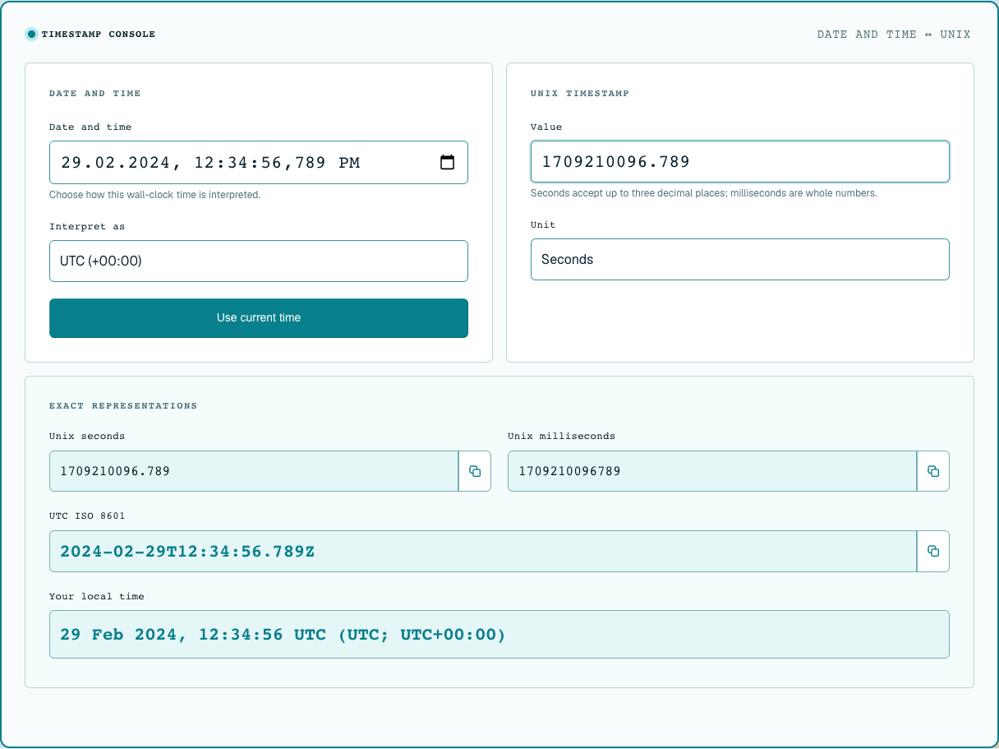

# Timestamp

A local-first Unix timestamp converter. Convert Unix seconds or milliseconds to a date-time and back, and read the same instant as Unix seconds, Unix milliseconds, UTC ISO 8601 and your browser's local time.

It is for developers who check log timestamps, API payloads or database values and want an exact answer without a server round trip.

**Live:** [timestamp.themkvz.com](https://timestamp.themkvz.com)



## Features

- Two-way conversion: edit the Unix value or the date-time, and the other side updates.
- Millisecond precision. Seconds accept up to three decimal places; milliseconds must be whole numbers.
- Local or UTC interpretation of the entered date-time, with daylight-saving gaps rejected and overlaps resolved to the earlier offset.
- Full JavaScript `Date` range, including negative timestamps and years before 100.
- One-click copy for each output, with a fallback when clipboard access is blocked.
- Accessible: labelled controls, keyboard navigation, live status messages, and support for dark, reduced-motion and forced-colors modes.
- FAQ page that works without JavaScript.

## Usage examples

| Input | Unit / mode | Result |
| --- | --- | --- |
| `1709210096.789` | seconds | `2024-02-29T12:34:56.789Z` |
| `1709210096789` | milliseconds | `2024-02-29T12:34:56.789Z` |
| `-0.001` | seconds | `1969-12-31T23:59:59.999Z` (`-1` ms) |
| `1.2` | milliseconds | error: "Enter a signed whole number of milliseconds." |
| `2024-02-29 12:34:56.789` | UTC | `1709210096.789` s |
| `2024-03-10 02:30` | Local, America/New_York | error: "This local time does not exist." (DST gap) |
| `2024-11-03 01:30` | Local, America/New_York | `1730611800` s (earlier offset, EDT) |

## Privacy

There are two separate things to know:

- **Your values stay in the page.** Conversion runs entirely in your browser. The Unix values and date-times you enter or copy are never sent anywhere. There is no API or server runtime.
- **Usage analytics are collected.** The pages load self-hosted [OpenPanel](https://openpanel.dev) from `https://openpanel.themkvz.com`. It records page views, outgoing link clicks and interaction events: which field was used, the selected unit and time-zone mode, which navigation link, copy button or FAQ question was used. These events never include the values you enter or the converted results.

## Architecture

- **Static site, no backend.** Bun bundles `index.html` and `faq.html` into `dist/` ([scripts/build.ts](scripts/build.ts)). Cloudflare Pages serves the files; [wrangler.jsonc](wrangler.jsonc) has no bindings or functions.
- **Pure conversion core.** [src/timestamp/time.ts](src/timestamp/time.ts) parses and formats with integer milliseconds and explicit date parts, so results do not depend on locale parsing. Natural-language dates are not accepted on purpose.
- **Thin DOM layer.** [src/timestamp/converter.ts](src/timestamp/converter.ts) connects the form to a single [nanostores](https://github.com/nanostores/nanostores) atom that holds the current instant, unit and mode.
- **UI.** Plain HTML with [Oat](https://oat.ink) styles and the Geist font. No framework.
- **Specs.** Requirements and design decisions live in [openspec/specs](openspec/specs) and [openspec/changes/archive](openspec/changes/archive).

## Development

Requires [Bun](https://bun.sh) 1.4.2 (the version pinned for the Pages build).

```sh
bun install --frozen-lockfile
bun run dev
```

Open the URL printed by Bun. The FAQ is at `/faq`.

## Testing

```sh
bun run check
bun run test
bun run build
```

- `check` runs Biome format and lint checks, then TypeScript.
- `test` rebuilds `dist/`, then runs conversion, DOM (happy-dom), accessibility (axe-core) and discoverability tests with `TZ=America/New_York`, so daylight-saving cases are stable.

Browser smoke test: convert a Unix value and a UTC date-time in both directions, Tab through the controls, test Copy with and without clipboard access, visit `/faq/`, check a narrow viewport plus dark, reduced-motion and forced-colors modes, and disable JavaScript for the FAQ. Confirm that every request goes to the serving origin or to `https://openpanel.themkvz.com`, and that no analytics request contains an entered value.

## Contributing

Issues and pull requests are welcome. A Lefthook pre-commit hook runs `bun run check`. Please run `bun run test` before opening a pull request, and add a test for any change to conversion behavior.

## Deployment — separate approval required

Do not deploy without explicit approval from the maintainer.

The production site is a Cloudflare Pages project serving `dist/` at `timestamp.themkvz.com`. The only Wrangler variable is `BUN_VERSION`, which pins Bun for the Pages build. After approval, upload a verified build:

```sh
bunx wrangler pages deploy dist --project-name timestamp
```

Then run the browser smoke test against the production origin. To roll back, restore the previous Pages deployment.

## License

[MIT](LICENSE)
